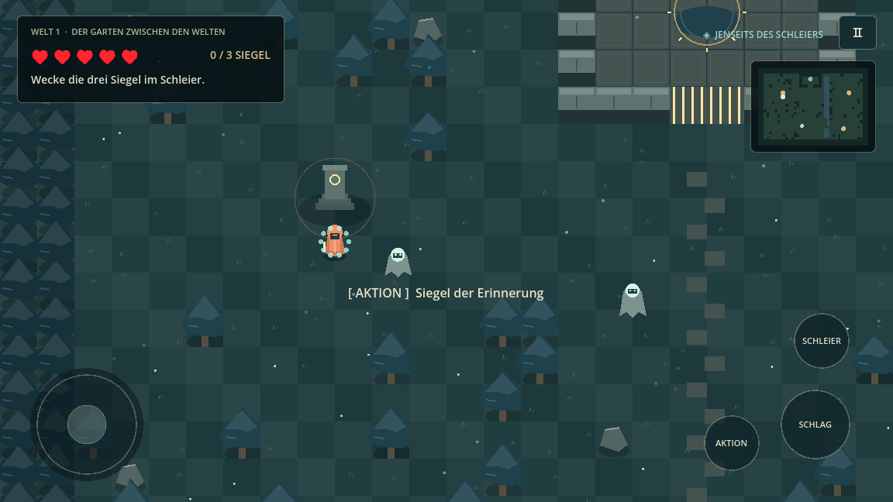

# The Veil of the Æon

Ein spielbarer 2D-Prototyp von Andrés Spielidee: ein atmosphärisches Abenteuer über verborgene Welten, Erinnerung, Erkenntnis und Willen. Entwickelt mit Godot 4.7 stable und GDScript für Querformat und Touchsteuerung.

**Version 0.2 · Kapitel I: Der Garten zwischen den Welten**



## Neu in 0.2

- Auf Godot 4.7 geprüft, mit separater Startanzeige und unabhängigem Bildtest.
- Gespeicherte Helligkeit unter **Bild & Ton**; Spielwelt standardmäßig etwas heller.
- Eigene Weltszene für den Garten und gemeinsame Grundlage für weitere Welten.
- Spielstände je besuchter Welt; Dateien aus Version 0.1 werden übernommen und vor der ersten Umwandlung gesichert.
- Ein Plan für bis zu 33 Welten ist hinterlegt. **Spielbar ist weiterhin Welt 1.**

Der schwarze Bildschirm auf deinem Handy wurde hier noch nicht nachgestellt. Bitte die neue Version frisch importieren. Bei erneut schwarzem Bild die Anleitung [Schwarzer Bildschirm](docs/SCHWARZER_BILDSCHIRM.md) und den enthaltenen Bildtest verwenden.

## Sofort ausprobieren

### Auf deinem Android-Handy

1. Lade das Projekt-ZIP herunter. Du brauchst den **Godot Editor 4.7 für Android**, nicht nur die GitHub-App.
2. Öffne den Godot-Projektmanager und wähle **Importieren**. Wähle das ZIP aus und gib einen beschreibbaren Projektordner an. Falls die Dateiauswahl kein ZIP annimmt, entpacke es zuerst und importiere die darin enthaltene `project.godot`.
3. Öffne das importierte Projekt und tippe auf **Projekt ausführen / ▶**.
4. Halte das Handy im Querformat und wähle **Neue Reise beginnen**. Links bewegst du dich mit dem Joystick, rechts findest du **SCHLAG**, **AKTION** und **SCHLEIER**.

Das ZIP ist das **vollständige Godot-Projekt**, keine installierbare APK. Ein Android-APK-Export und ein Test auf deinem konkreten Handy stehen noch aus. Das Projekt lässt sich im Godot-Editor ausführen.

### Auf Windows, Linux oder macOS

1. ZIP entpacken.
2. Godot 4.7 öffnen und `project.godot` importieren. Entwickelt und geprüft wurde mit **Godot 4.7 stable**.
3. **F6** startet eine einzelne Szene; **F5 / ▶** startet dieses Projekt.

Die Hauptszene `scenes/startup.tscn` und die Steuertasten sind fertig eingerichtet. Du musst keine Gruppen, Autoloads oder Player-Pfade von Hand einstellen.

## Steuerung

| Aktion | Tastatur | Android |
| --- | --- | --- |
| Bewegen | WASD oder Pfeiltasten | Joystick links |
| Schwertschlag | J oder Leertaste | SCHLAG |
| Sprechen / Siegel / Tor | E oder Enter | AKTION |
| Welt wechseln | V oder K | SCHLEIER |
| Pause | Esc oder P | Ⅱ oben rechts / Android-Zurück |
| Dialog fortsetzen | E, Enter oder Weiter | Weiter |

Der Angriff lässt sich gedrückt halten. Bewegung und Angreifen funktionieren gleichzeitig mit verschiedenen Fingern. Beim Wechsel zu einer anderen App pausiert das Spiel und setzt gehaltene Berührungen zurück.

## Dein erster Auftrag

1. Gehe vom Lagerfeuer nach links oben zum Hüter. Sprich ihn mit **AKTION / E** an und lies seine Hinweise.
2. Wechsle mit **SCHLEIER / V** in die verborgene Welt. Die drei goldenen Punkte auf der Karte markieren die Siegel.
3. Gehe zu jedem Siegelstein und drücke in seiner Nähe **AKTION / E**. Das Wecken eines Siegels heilt dich.
4. Verteidige dich gegen die Schatten. Vor einem Gegenschlag kündigt ein roter Kreis ihren Angriff an. In der sichtbaren Welt sind sie harmlos.
5. Die nördliche Flussbrücke existiert nur im Schleier; die südliche ist immer begehbar. Auf der Geisterbrücke kannst du nicht in die sichtbare Welt wechseln.
6. Wenn alle drei Siegel erwacht sind, öffnet sich das Tor im nördlichen Tempel. Betritt den Kreis dahinter und drücke **AKTION / E**, um das Kapitel abzuschließen.

Beim Hüter kannst du dich jederzeit heilen lassen. Wenn deine Herzen leer sind, wachst du am Lagerfeuer auf und behältst deine Siegel.

## Bild & Ton

Im Titelmenü oder über Pause kannst du **Bild & Ton** öffnen. Die Helligkeit betrifft die Spielwelt; Schrift und Bedienelemente bleiben lesbar. Einstellungen werden getrennt vom Questfortschritt gespeichert. Der Knopf **Bildtest öffnen** führt zu einer unabhängigen Anzeige mit Farbfeldern und einem Startbericht.

## Spielstände

Der Fortschritt wird nach wichtigen Ereignissen und beim Pausieren automatisch lokal gespeichert: freigeschalteter Schleier, erwachte Siegel, besiegte Gegner und Kapitelabschluss. Fortsetzen beginnt am sicheren Lagerfeuer in der sichtbaren Welt. Eine beschädigte oder inkompatible Datei führt zurück zur Option für eine neue Reise.

Die Version 0.2 verwaltet zusätzlich einzelne Fortschrittsstände pro Welt. Eine gültige Datei aus Version 0.1 wird automatisch eingelesen. Vor der ersten Umwandlung wird die ursprüngliche Datei unter `veil_save.json.v1.bak` gesichert.

Es gibt keine Konten, Werbung, In-App-Käufe, Netzwerkverbindungen oder Cloud-Spielstände im Spiel. Die Godot-Datei heißt `user://veil_save.json`. Beim Entpacken an einen anderen Ort bleibt sie im jeweiligen Godot-Nutzerverzeichnis. Browser, Handy und PC haben getrennte Spielstände.

## Auf GitHub weiterentwickeln

Das Projekt liegt im Repository [stroblandre-debug/test](https://github.com/stroblandre-debug/test). `project.godot` befindet sich direkt im Stammverzeichnis; die Projektdateien können dort weiterentwickelt werden.

1. Lade den aktuellen Stand über **Code → Download ZIP** herunter oder verwende [diesen ZIP-Link](https://github.com/stroblandre-debug/test/archive/refs/heads/main.zip).
2. Entpacke das ZIP und importiere die enthaltene `project.godot` in Godot.
3. Änderungen am Spiel werden als einzelne Dateien im Repository gespeichert. Ein zusätzliches Projekt-ZIP muss nicht hochgeladen werden.
4. Der Workflow unter `.github/workflows/verify.yml` importiert das Projekt, führt die Tests einschließlich Startfehler-Prüfung aus und legt ein Quellcode-ZIP als Actions-Artefakt ab. Den aktuellen Ausführungsstatus findest du unter [Actions](https://github.com/stroblandre-debug/test/actions).

GitHub verwaltet hier den Code und die Änderungen. Zum Ausführen dient Godot. GitHub Pages oder eine Website werden mit dieser Version nicht eingerichtet.

## Aufbau

| Datei | Aufgabe |
| --- | --- |
| `project.godot` | Startszene, Querformat und Darstellung |
| `scenes/startup.tscn` | Unabhängiger Startbildschirm und Fehleranzeige |
| `scenes/bildtest.tscn` | Separater Bildtest |
| `scenes/main.tscn` | Spiel und Menüs |
| `worlds/garden.tscn` | Welt 1 als eigene Szene |
| `scripts/base_world.gd` | Gemeinsame Kollision und Schleierregeln |
| `scripts/world_manager.gd` | Geladene Welt und Szenenwechsel |
| `scripts/world_catalog.gd` | Vorhandene und geplante Welten unterscheiden |
| `data/worlds.json` | 33 vorgesehene Positionen; Welt 1 spielbar |
| `scripts/preferences.gd` | Getrennte Anzeige- und Klangeinstellungen |
| `scripts/game.gd` | Spielablauf, Dialoge, Menüs und Quest |
| `scripts/world.gd` | Karte, Gelände, Siegel und Kollisionen |
| `scripts/player.gd` | Bewegung, Schwert und Schaden |
| `scripts/shade.gd` | Schattengegner mit angekündigten Angriffen |
| `scripts/touch_controls.gd` | Touch-Joystick und Mehrfingersteuerung |
| `scripts/minimap.gd` | Karte und Zielmarkierungen |
| `scripts/save_game.gd` | Validierte lokale Spielstände |
| `scripts/atmosphere.gd` | Feuer, Leuchtpartikel und Effekte |
| `scripts/sound.gd` | Kurze synthetische Klänge |
| `tests/` | Prüfungen und optionaler Bildexport |

Grafik und Klänge entstehen im Code; externe Spielgrafik wird nicht benötigt. Die beigefügte DejaVu-Serif-Schrift und ihre Lizenz liegen unter `assets/`. Für die Gesamtveröffentlichung des Spiels wurde keine Open-Source-Lizenz festgelegt.

## Prüfung

Mit installiertem Godot und Python 3 im Projektordner:

```bash
python3 tests/check_project.py
```

Alternativer Pfad zum Godot-Programm: Umgebungsvariable `GODOT_BIN` setzen. Der Prüflauf importiert die Ressourcen, prüft 142 Fälle zu Spielablauf, Kampf, Touchsteuerung, Kollisionen und Spielständen und startet das Titelmenü für 120 Frames. Zusätzlich prüfen zwei isolierte Projektkopien die sichtbare Fehleranzeige bei einem beschädigten Spielskript oder einer fehlenden Startwelt. Testspielstände sind vom normalen Spielstand getrennt.

Der optionale Befehl `godot --path . --script res://tests/render_preview.gd` erzeugt Ansichten unter `build/preview/`; er braucht einen grafischen Bildschirm. Zum Anzeigen der Touchsteuerung auf einem PC kannst du `godot --path . -- --touch` verwenden.

## Geprüfter Stand und nächste Erweiterungen

- Godot 4.7 stable: Ressourcenimport, 142 automatisierte Integrationsprüfungen und Startprüfung bestanden.
- Grafische Prüfung: Titelbild, Spielwelt, Schleierwelt und Dialog mit dem Godot-Compatibility-Renderer auf Linux.
- Noch offen: Test auf echtem Android-Gerät, APK-Export, tatsächlicher GitHub-Actions-Lauf und längerer Spieltest mit echten Fingereingaben.
- Die Version enthält ein abgeschlossenes kleines Kapitel. Weitere Kapitel, große Dungeons, Inventar, längere Musikstücke und aufwendig animierte Figuren sind mögliche nächste Schritte.

## Technische Referenzen

- [Godot 4.7 stable – offizieller Download](https://godotengine.org/download/archive/4.7-stable/)
- [Godot-Dokumentation: Kommandozeile](https://docs.godotengine.org/en/4.7/tutorials/editor/command_line_tutorial.html)
- [Godot-Dokumentation: Android-Editor](https://docs.godotengine.org/en/stable/tutorials/editor/using_the_android_editor.html)


## Planung und Prüfung im Detail

- [Abgesprochener Weltenplan](docs/WELTENPLAN.md)
- [Schwarzen Bildschirm eingrenzen](docs/SCHWARZER_BILDSCHIRM.md)
- [Prüfbericht und offene Punkte](docs/PRUEFBERICHT.md)
- [Änderungen](CHANGELOG.md)

Für einen späteren APK-/Desktop-Export muss der Exportfilter auch `data/*.json` einschließen, damit der Weltenkatalog mitgeliefert wird. Ein Exportpaket wird in dieser Fassung noch nicht erzeugt.
